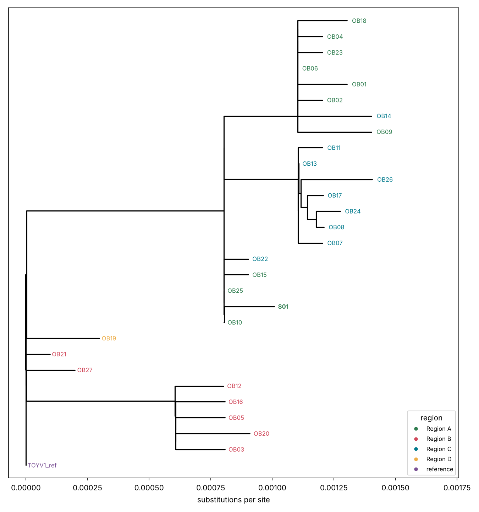
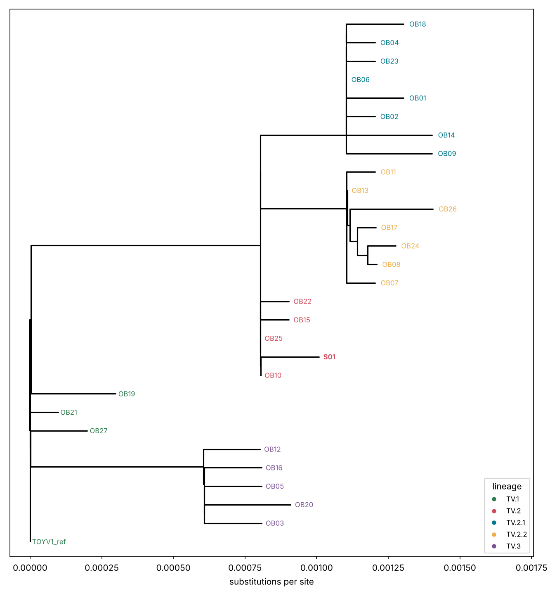

## Anatomy of a tree

- **Tips** = the genomes you sequenced. **Internal nodes** = inferred common ancestors.
- **Branch length** = amount of change (substitutions per site), *not* time (unless the tree is time-scaled).
- **Clade** = an ancestor and *all* its descendants. Rotating the branches around a node does not change the tree.
- **Root** = where the tree starts. Without a root you cannot say who is ancestral.
- **Support** (bootstrap) = how robust a branch is. With ultrafast bootstrap, a value ≥ 95 is considered strong; be careful with lower values.

## What a tree can and cannot tell

| It can show | It cannot prove |
|---|---|
| which genomes are closely related | who infected whom |
| whether cases form one cluster or several introductions | the direction of transmission |
| whether a lineage spreads across regions | that two similar genomes are epidemiologically linked |

## Exercise — read the tree

The figure below was made from the course data with the plan-B method (neighbour-joining). Open yours too: it should look similar.

{width=85%}

{width=85%}

Dates and regions are in `data/outbreak/metadata.tsv`. To sort the genomes by date:

```bash
sort -t$'\t' -k2,2 data/outbreak/metadata.tsv | column -t -s $'\t'
```

**Questions**

1. Where is S01? Who are its closest relatives?
2. How many clusters do you see, and in which regions?
3. Which part of the tree is the oldest? (use the dates)
4. Do the Region C cases form one cluster or several? What does it suggest?

::: {.callout-tip collapse="true"}
## Answers
1. S01 is in the **TV.2** group, next to **OB10, OB25, OB15 and OB22** (2–3 SNPs away). OB10, OB25 and OB15 are Region A genomes
   from 2–4 March: S01 (2 March, Region A) fits perfectly with the start of the Region A outbreak. OB22 is a Region C genome (12 March).
2. **Four groups** hang from the root: (i) background **TV.1** genomes (Regions B and D, January–February), (ii) **TV.3** (Region B,
   February–March), (iii) the **TV.2** early group (Region A, with one Region C genome), and, derived from it, (iv) two
   sub-clades: **TV.2.1** (almost all Region A) and **TV.2.2** (Region C).
3. The **oldest** genomes are the TV.1 ones (January–February) and the TV.3 ones (February–March), close to the root. The TV.2 group
   starts in early March; TV.2.1 and TV.2.2 appear from late March: the tree order matches the dates.
4. **One main cluster** (TV.2.2: 7 genomes, from 25 March) plus **two other Region C genomes** that belong to other groups (OB22, an early
   TV.2, and OB14, a TV.2.1). This suggests several links between regions A and C: an introduction of the early TV.2 virus
   followed by **local transmission** (the TV.2.2 cluster), and a later exchange (OB14). Direction cannot be proved by the tree alone.
:::

## Final question

Two genomes are identical. List three explanations other than "A infected B".

::: {.callout-tip collapse="true"}
## Answer
- **Too few mutations** to tell them apart: viruses change slowly, so unrelated cases can have the same sequence over a short period.
- A **common source** (same event, same contaminated food/animal) that infected both without contact between them.
- A **common ancestor several steps earlier**, with unsampled intermediate cases (you only see part of the chain).
- **Laboratory contamination** or barcode bleed between the two samples.
- Missing data: identical *on the positions that could be compared* (N regions hide differences).
:::

**Next:** [Communicating genomic evidence](04-evidence.qmd) — module 4.
